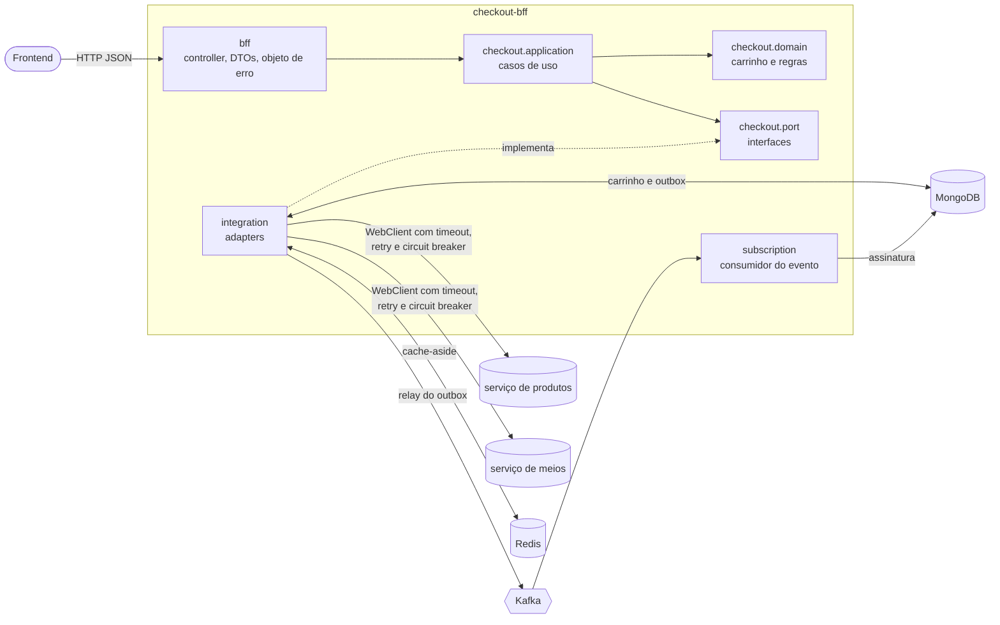
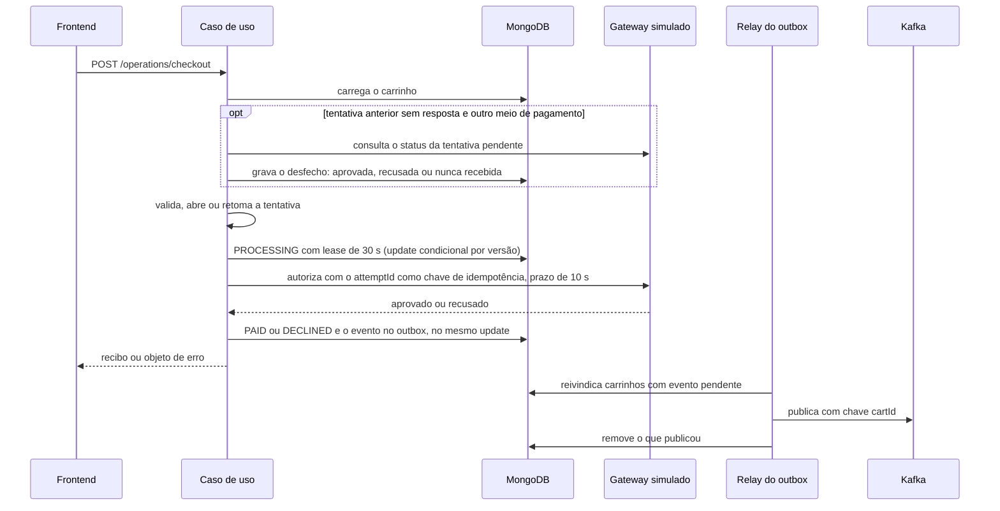
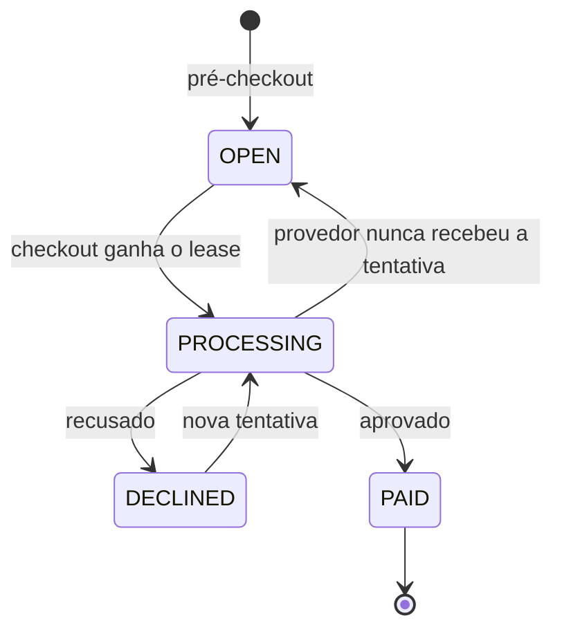

# checkout-bff

[](https://github.com/magnolett/checkout-bff/actions/workflows/ci.yml)

BFF (Backend for Frontend) de um checkout de assinatura. Ele monta o carrinho a partir de um serviço de
produtos e de um serviço de meios de pagamento, conclui o pagamento simulado e devolve ao frontend só o
que cada tela precisa. Toda falha que a tela exibe sai no mesmo objeto de erro.

Java 25, Spring Boot 4.1 com WebFlux, MongoDB, Redis, Kafka, Resilience4j, Testcontainers e Docker Compose.

- [Como rodar](#como-rodar)
- [Como simular cada cenário](#como-simular-cada-cenário)
- [Contrato da API](#contrato-da-api)
- [Arquitetura](#arquitetura)
- [Decisões](#decisões)
- [Dado de cartão](#dado-de-cartão)
- [Testes](#testes)
- [Observabilidade](#observabilidade)
- [Limitações e próximos passos](#limitações-e-próximos-passos)
- [Como usei IA](#como-usei-ia)

## Como rodar

Requisito: Docker com Compose v2. Para rodar os testes ou a aplicação fora do Docker, JDK 25 (o Maven
vem pelo wrapper `./mvnw`).

```bash
docker compose up -d --build --wait
```

O comando só retorna quando a API responde à sonda de readiness. Sobem seis containers:

| Serviço | Endereço no host | Papel |
|---|---|---|
| `bff` | http://localhost:8080 | a API |
| `products-service` | http://localhost:8081 | serviço de produtos simulado em WireMock |
| `payment-methods-service` | http://localhost:8082 | serviço de meios de pagamento simulado em WireMock |
| `mongo` | localhost:27017 | carrinhos e assinaturas |
| `redis` | localhost:6379 | cache dos catálogos |
| `kafka` | localhost:9092 | eventos de pagamento |

A documentação interativa fica em http://localhost:8080/swagger-ui.html, com o exemplo de sucesso e dos
erros principais. Para desligar e apagar os dados, `docker compose down -v`.

Para rodar a aplicação pela IDE, suba só a infraestrutura. A configuração padrão já aponta para
`localhost`:

```bash
docker compose up -d --wait mongo redis kafka products-service payment-methods-service
./mvnw spring-boot:run
```

## Como simular cada cenário

Os exemplos usam `curl` num shell bash (Linux, macOS ou Git Bash). O corpo vai pelo stdin
(`--data-binary @-`) porque assim chega em UTF-8 em qualquer terminal, e "Cartão de Crédito" tem acento.
Os mesmos cenários estão em [`requests.http`](requests.http), para o cliente HTTP do IntelliJ.

Cartões de teste:

| Número | Resultado |
|---|---|
| `4242424242424242` | aprovado |
| `4111111111114242`, o do enunciado | aprovado (não há validação de Luhn, ver o [ADR 0009](docs/adr/0009-dado-de-cartao.md)) |
| qualquer número terminado em `0002`, como `4000000000000002` | recusado |

A validade segue o formato `MM/AA` e não pode estar vencida. O CVV tem 3 ou 4 dígitos.

### 1. Pré-checkout

```bash
curl -s localhost:8080/operations/pre-checkout -H 'Content-Type: application/json' --data-binary @- <<'EOF'
{"products": [{"slug": "premium"}]}
EOF
```

```json
{
  "cartId": "5e4d354c-31e3-4d80-aa69-251e2b3e674f",
  "products": [
    {
      "slug": "premium",
      "name": "Plano Premium",
      "description": "Assinatura mensal com catálogo completo",
      "price": 39.90,
      "currency": "BRL"
    }
  ],
  "paymentMethods": [
    { "name": "Cartão de Crédito" },
    { "name": "Cartão de Débito" },
    { "name": "Pix" }
  ]
}
```

Os planos são `basico` (19,90), `premium` (39,90) e `familia` (59,90), e podem ir juntos no mesmo
carrinho. Para guardar o `cartId` e usar nos próximos passos:

```bash
CART=$(curl -s localhost:8080/operations/pre-checkout -H 'Content-Type: application/json' \
  -d '{"products":[{"slug":"premium"}]}' | sed -E 's/.*"cartId":"([^"]+)".*/\1/')
```

### 2. Pagamento aprovado

```bash
curl -s localhost:8080/operations/checkout -H 'Content-Type: application/json' --data-binary @- <<EOF
{"cartId": "$CART", "paymentMethod": {"name": "Cartão de Crédito",
  "card": {"holderName": "Ana Souza", "number": "4242424242424242", "expiry": "12/30", "cvv": "123"}}}
EOF
```

```json
{
  "cartId": "5e4d354c-31e3-4d80-aa69-251e2b3e674f",
  "status": "APROVADO",
  "paidAt": "2026-11-14T20:55:03Z",
  "payment": {
    "method": "Cartão de Crédito",
    "lastDigits": "4242",
    "pixCode": null,
    "amount": 39.90,
    "currency": "BRL"
  },
  "products": [
    { "slug": "premium", "name": "Plano Premium", "price": 39.90 }
  ]
}
```

No cartão o `pixCode` vem `null`, e no Pix é o `lastDigits` que vem `null`. As duas chaves aparecem
sempre, para o formato da resposta não variar entre os meios.

### 3. Pagamento recusado

Num carrinho novo, o mesmo pedido com o cartão `4000000000000002` responde 422:

```json
{
  "displayType": "BLOCK",
  "errorCode": "PAYMENT_DECLINED",
  "cartId": "5e4d354c-31e3-4d80-aa69-251e2b3e674f",
  "frontendError": {
    "code": "P-1001",
    "title": "Pagamento não aprovado",
    "description": "Não foi possível concluir o pagamento. Tente novamente ou escolha outro meio.",
    "primaryButton": { "label": "Tentar novamente", "url": "RETRY" },
    "secondaryButton": { "label": "Trocar meio de pagamento", "url": "/checkout/pagamento" }
  }
}
```

A recusa não encerra o carrinho, porque a tela oferece "Tentar novamente" e "Trocar meio de pagamento".
Pagar de novo o mesmo carrinho com o cartão `4242424242424242` aprova.

### 4. Pix

```bash
curl -s localhost:8080/operations/checkout -H 'Content-Type: application/json' --data-binary @- <<EOF
{"cartId": "$CART", "paymentMethod": {"name": "Pix"}}
EOF
```

A resposta traz `"lastDigits": null` e um código como `"pixCode": "E99999999202611142055RYVZ48BP18P"`. O
código segue o formato do `endToEndId` do Banco Central, o identificador que aparece no comprovante de um
Pix: `E`, o ISPB do participante (8 dígitos), a data e hora em UTC (`AAAAMMDDHHMM`) e 11 caracteres
alfanuméricos, 32 no total.

### 5. Outras falhas de negócio

| Cenário | Como provocar | Resposta |
|---|---|---|
| Carrinho já pago | pagar de novo um carrinho aprovado | 409 `CART_ALREADY_PAID` |
| Produto inexistente | pré-checkout com `{"slug": "inexistente"}` | 422 `PRODUCT_NOT_FOUND`, com `cartId: null` |
| Carrinho inexistente | checkout com um `cartId` qualquer | 404 `CART_NOT_FOUND` |
| Meio fora do carrinho | checkout com `{"name": "Boleto"}`, que o serviço de meios devolve desabilitado | 422 `PAYMENT_METHOD_NOT_ALLOWED` |
| Dado de pagamento inválido | validade vencida (`"expiry": "01/20"`), cartão ausente no crédito ou cartão enviado no Pix | 400 `INVALID_PAYMENT_DATA` |
| Carrinho expirado | pagar mais de 30 minutos depois do pré-checkout | 422 `CART_EXPIRED` |

### 6. Duplo clique

O gateway simulado aceita uma latência configurável, o que deixa a janela de corrida visível:

```bash
PAYMENT_GATEWAY_LATENCY=3s docker compose up -d --wait
```

Com um carrinho novo em `$CART`, grave o pedido num arquivo e dispare duas vezes ao mesmo tempo:

```bash
cat > pagamento.json <<EOF
{"cartId": "$CART", "paymentMethod": {"name": "Cartão de Crédito",
  "card": {"holderName": "Ana Souza", "number": "4242424242424242", "expiry": "12/30", "cvv": "123"}}}
EOF
for i in 1 2; do
  curl -s -o /dev/null -w '%{http_code}\n' localhost:8080/operations/checkout \
    -H 'Content-Type: application/json' --data-binary @pagamento.json &
done; wait
```

Uma chamada devolve `200` e a outra `409` (`PAYMENT_IN_PROGRESS`), em qualquer ordem, e o carrinho
termina com uma única tentativa de cobrança. Para voltar ao normal, `docker compose up -d --wait`.

### 7. Resposta perdida e `Idempotency-Key`

Se o pagamento aprova e a resposta se perde no caminho, o "Tentar novamente" do front repetiria o pedido e
receberia `CART_ALREADY_PAID` numa compra que deu certo. Para esse caso o checkout aceita o header
opcional `Idempotency-Key`. Repetir com a mesma chave devolve o resultado original, sem cobrar de novo:

```bash
curl -s localhost:8080/operations/checkout -H 'Content-Type: application/json' \
  -H 'Idempotency-Key: pedido-123' --data-binary @- <<EOF
{"cartId": "$CART", "paymentMethod": {"name": "Cartão de Crédito",
  "card": {"holderName": "Ana Souza", "number": "4242424242424242", "expiry": "12/30", "cvv": "123"}}}
EOF
```

Rodar o comando duas vezes devolve a mesma resposta, com o mesmo `paidAt`. A mesma chave com outro
cartão responde 422 `IDEMPOTENCY_KEY_REUSED`. A regra para o front é gerar uma chave por intenção de
pagamento: depois de uma recusa, a nova tentativa leva chave nova; depois de timeout ou 503, repete a
mesma chave, porque o resultado ficou desconhecido. Sem o header, o comportamento é o do enunciado. Se o
front gerar chave nova depois de um 503 e mandar o mesmo cartão, a tentativa pendente é retomada e passa a
responder pelas duas chaves.

### 8. Falha técnica

```bash
docker compose stop products-service
docker compose exec redis redis-cli FLUSHALL   # sem isso o catálogo ainda responde pelo cache
```

O pré-checkout passa a responder 503 com o mesmo objeto de erro (`SERVICE_UNAVAILABLE`, botão "Tentar
novamente"). As primeiras chamadas levam até uns 3 segundos (três tentativas com timeout de 1 segundo).
Depois de algumas falhas o circuit breaker abre e o 503 sai em milissegundos. Com o serviço de volta
(`docker compose start products-service`), o circuito se recupera sozinho em até 10 segundos.

### 9. A assinatura ativada pelo evento

Cada pagamento aprovado gera um evento no Kafka, e um consumidor ativa a assinatura no MongoDB:

```bash
docker compose exec mongo mongosh checkout --quiet --eval 'db.subscriptions.find().toArray()'
docker compose exec kafka /opt/kafka/bin/kafka-console-consumer.sh --bootstrap-server localhost:9092 \
  --topic checkout.payment-events --from-beginning --property print.key=true --timeout-ms 10000
```

No Git Bash, prefixe o segundo comando com `MSYS_NO_PATHCONV=1`, senão o caminho `/opt/...` é convertido
para um caminho do Windows.

### 10. Resposta perdida e troca de meio

O caso mais delicado do pagamento: o provedor cobra, mas a resposta não volta a tempo. Para reproduzir,
suba o BFF com o gateway mais lento que o prazo de 10 segundos:

```bash
PAYMENT_GATEWAY_LATENCY=12s docker compose up -d --wait bff
```

Pague um carrinho novo com o cartão aprovado (cenário 2). Depois de 10 segundos vem um 503
`SERVICE_UNAVAILABLE`, mas o gateway simulado já tinha registrado a cobrança, como um provedor real que
decide e responde tarde demais. Agora tente o mesmo carrinho com Pix:

```bash
curl -s localhost:8080/operations/checkout -H 'Content-Type: application/json' --data-binary @- <<EOF
{"cartId": "$CART", "paymentMethod": {"name": "Pix"}}
EOF
```

A resposta é 409 `CART_ALREADY_PAID`, e o Pix não é cobrado. Antes de aceitar outro meio, o checkout
pergunta ao provedor o que aconteceu com a tentativa sem resposta, descobre a aprovação e fecha o carrinho
com ela, com evento e assinatura ativada. Se o provedor tivesse recusado ou nunca recebido a tentativa, o
Pix seguiria normalmente. Para voltar ao normal, `docker compose up -d --wait bff`.

## Contrato da API

### `POST /operations/pre-checkout`

Corpo e resposta como no enunciado. O pedido leva de 1 a 10 produtos. O slug aceita letras, dígitos e
hífen e é normalizado para minúsculas. Produto repetido responde 400, porque o contrato não tem campo de
quantidade.

### `POST /operations/checkout`

Corpo como no enunciado, com o header opcional `Idempotency-Key` (1 a 100 caracteres entre letras,
dígitos e `_-:.`). O sucesso responde 200 no formato do enunciado, com `lastDigits` e `pixCode` sempre
presentes.

### Objeto de erro

Toda falha usa o mesmo objeto, com todas as chaves sempre presentes: `cartId` vem `null` quando ainda não
existe carrinho, e `secondaryButton` vem `null` quando a tela tem uma ação só.

| `errorCode` | HTTP | `displayType` | `code` | Quando |
|---|---|---|---|---|
| `PRODUCT_NOT_FOUND` | 422 | BLOCK | C-1001 | slug inexistente no pré-checkout |
| `PRODUCTS_NOT_COMBINABLE` | 422 | BLOCK | C-1005 | planos com preço em moedas diferentes no mesmo pedido |
| `CART_NOT_FOUND` | 404 | BLOCK | C-1002 | `cartId` desconhecido |
| `CART_EXPIRED` | 422 | BLOCK | C-1003 | carrinho com mais de 30 minutos |
| `CART_ALREADY_PAID` | 409 | BLOCK | C-1004 | carrinho já aprovado |
| `PAYMENT_DECLINED` | 422 | BLOCK | P-1001 | recusa do emissor (cartão terminado em 0002) |
| `PAYMENT_METHOD_NOT_ALLOWED` | 422 | INTERVENTION | P-1002 | meio fora dos ofertados naquele carrinho |
| `INVALID_PAYMENT_DATA` | 400 | INTERVENTION | P-1003 | cartão ausente, inválido ou enviado no Pix |
| `PAYMENT_IN_PROGRESS` | 409 | INTERVENTION | P-1004 | outra requisição está pagando o mesmo carrinho |
| `IDEMPOTENCY_KEY_REUSED` | 422 | INTERVENTION | P-1005 | mesma chave com outro pagamento |
| `INVALID_REQUEST` | 400 | BLOCK | G-1001 | JSON malformado ou campo obrigatório ausente |
| `SERVICE_UNAVAILABLE` | 503 | BLOCK | S-1001 | dependência fora do ar ou sem resposta a tempo |
| `INTERNAL_ERROR` | 500 | BLOCK | S-1002 | erro inesperado |

Falha de negócio sai em 4xx, como o enunciado pede. Falha técnica sai em 5xx com o mesmo objeto, então o
front trata tudo pelo formato e o monitoramento continua enxergando o incidente ([ADR 0003](docs/adr/0003-falha-tecnica-em-5xx.md)).
`INTERVENTION` fica com o que o usuário corrige sem sair da tela. A recusa usa 422 e não 402, que a RFC
9110 mantém reservado. Rota inexistente (404), método errado (405) e `Accept` ou `Content-Type` não
suportados (406 e 415) mantêm o status HTTP e também devolvem o objeto, com `INVALID_REQUEST`.

## Arquitetura



| Pacote | Responsabilidade | Pode depender de |
|---|---|---|
| `bff` | HTTP: controller, DTOs, tradução de exceção para o objeto de erro | `checkout` |
| `checkout.domain` | regras puras: carrinho, tentativas, máquina de estados, validação do cartão | só do Java |
| `checkout.port` | interfaces de que os casos de uso precisam: catálogos, gateway, repositório | `domain` e Reactor |
| `checkout.application` | casos de uso: pré-checkout e checkout | `port` e `domain` |
| `integration` | adapters: clientes HTTP, cache, gateway simulado, MongoDB, Kafka e outbox | `port` e `domain` |
| `subscription` | consumidor que ativa a assinatura, no papel de outro serviço | nada do checkout, só do JSON do evento |

Essas fronteiras são verificadas a cada build pelo [`ArchitectureTest`](src/test/java/io/github/magnolett/checkoutbff/ArchitectureTest.java),
com ArchUnit. O BFF nunca lê produto nem meio de pagamento direto no endpoint: consome os dois serviços
por portas próprias, e os serviços rodam como processos separados em WireMock.

### Pré-checkout

Produtos e meios de pagamento são consultados ao mesmo tempo (`Mono.zip`), então a tela espera a consulta
mais lenta e não a soma das duas. Os produtos de um pedido com vários itens também são buscados em
paralelo, mantendo a ordem pedida. Cada consulta passa primeiro pelo cache no Redis e, na falta, pelo
cliente HTTP do serviço. O carrinho é gravado no MongoDB com o snapshot do que a tela mostrou (preços e
meios ofertados) e vale 30 minutos. É esse snapshot que o checkout cobra, então um preço que mude no meio
do caminho não altera o valor do pedido.

### Checkout





Só um pedido por vez passa para `PROCESSING`: quem perde o update condicional recebe
`PAYMENT_IN_PROGRESS`. O lease de 30 segundos impede que um carrinho fique travado se a instância cair no
meio da cobrança. Se o gateway falha ou não responde em 10 segundos, o lease é liberado, a tentativa fica
pendente e o cliente recebe 503. Um novo pedido com o mesmo cartão retoma a mesma tentativa, com o mesmo
`attemptId`, que é a chave de idempotência do provedor. Assim o retry nunca vira uma segunda cobrança
([ADR 0005](docs/adr/0005-idempotencia-do-pagamento.md)).

Com outro meio de pagamento não há o que retomar, e abandonar a tentativa pendente às cegas deixaria para
trás uma cobrança que pode ter acontecido. Por isso o checkout consulta antes o status dela no provedor.
Aprovada, o carrinho fecha com ela e o novo meio não é tocado. Recusada ou nunca recebida, ela é encerrada
e o novo meio segue. Sem resposta do provedor, 503 e nada muda. O domínio reforça a regra: ele se recusa a
abrir uma tentativa nova enquanto existir uma pendente sem desfecho.

Se o provedor responde e a gravação do desfecho falha, o carrinho relido decide a resposta: o desfecho
pode ter sido gravado com a confirmação perdida, ou outra requisição pode ter terminado a mesma tentativa
(recibo); outra requisição pode estar com ela agora (409); ou o banco falhou, e então o lease é liberado
para que o "Tentar novamente" retome a tentativa na hora (503).

O evento de pagamento é gravado no próprio documento do carrinho, no mesmo update que muda o estado, e um
relay agendado o publica no Kafka. Gravar o estado e publicar o evento nunca diverge, e não é preciso
transação entre documentos ([ADR 0008](docs/adr/0008-outbox-no-documento-do-carrinho.md)). A entrega é
pelo menos uma vez, e o consumidor é idempotente.

## Decisões

As decisões estão registradas em [`docs/adr`](docs/adr), cada uma com o contexto, as alternativas
consideradas e as consequências.

| ADR | Decisão |
|---|---|
| [0001](docs/adr/0001-stack-reativa.md) | Spring WebFlux com MongoDB reativo |
| [0002](docs/adr/0002-autorizacao-sincrona-e-eventos.md) | Autorização síncrona; ativação da assinatura por evento no Kafka |
| [0003](docs/adr/0003-falha-tecnica-em-5xx.md) | Falha técnica em 5xx com o mesmo objeto de erro |
| [0004](docs/adr/0004-estados-do-carrinho-e-concorrencia.md) | Máquina de estados, lock otimista e lease de processamento |
| [0005](docs/adr/0005-idempotencia-do-pagamento.md) | Retomada da tentativa pendente e `Idempotency-Key` opcional |
| [0006](docs/adr/0006-servicos-externos-e-resiliencia.md) | Serviços externos atrás de portas, com timeout, retry e circuit breaker |
| [0007](docs/adr/0007-cache-redis-fail-open.md) | Cache-aside no Redis que nunca derruba o checkout |
| [0008](docs/adr/0008-outbox-no-documento-do-carrinho.md) | Outbox embutido no documento do carrinho |
| [0009](docs/adr/0009-dado-de-cartao.md) | O que se valida e o que nunca se guarda do cartão |
| [0010](docs/adr/0010-java-25-e-spring-boot-4.md) | Java 25, Spring Boot 4.1 e Jackson 3 |

## Dado de cartão

O número completo e o CVV nunca são persistidos, logados nem publicados. Do cartão o carrinho guarda os
últimos quatro dígitos e uma impressão digital (SHA-256 do meio, dos últimos dígitos e da validade, nunca
do número completo), usada para reconhecer a retomada de uma tentativa. O `toString()` do cartão e do DTO
de entrada é mascarado, e a mensagem de validação traz só o nome do campo, sem ecoar o valor rejeitado. O
evento no Kafka não leva dado de cartão.

Isso é verificado por teste: o teste de integração lê o documento cru no MongoDB e procura o número
completo, e os testes do controller capturam o log e conferem que nem o número nem o CVV aparecem.

Num checkout real o número nem passaria pelo BFF: o front tokeniza o cartão direto no provedor de
pagamento e o BFF recebe só o token, fora do escopo PCI.

## Testes

```bash
./mvnw verify
```

Roda os testes de unidade (Surefire) e os de integração (Failsafe, classes `*IT`) contra MongoDB, Redis e
Kafka reais em Testcontainers, então precisa do Docker. São 335 testes, e a cobertura medida pelo JaCoCo
nas duas fases é de 98% das instruções e 88% dos ramos (relatório em `target/site/jacoco/index.html`).

| Camada | Como é testada | Testes |
|---|---|---|
| Domínio | JUnit puro, sem Spring: estados, retomada, desfecho de resposta perdida, validação do cartão, dinheiro | 92 |
| Casos de uso | repositório em memória com lock otimista de verdade, que também simula banco fora e confirmação perdida; tempo virtual do Reactor para timeout e paralelismo | 68 |
| Web e contrato de erro | `@WebFluxTest`: cada erro no formato exato, status, log sem dado de cartão | 116 |
| Adapters | WireMock para retry, timeout, 404, payload inválido e circuit breaker; cache que falha aberto; gateway simulado e consulta de status | 29 |
| Arquitetura | ArchUnit com as fronteiras entre pacotes | 8 |
| Integração | fluxo HTTP completo, duplo clique, idempotência, resposta perdida seguida de troca de meio, outbox até o Kafka, consumidor, DLT, ausência do número no banco | 22 |

O CI no GitHub Actions roda o mesmo `./mvnw verify` e depois constrói a imagem Docker.

## Observabilidade

- `GET /actuator/health`, com as sondas `/actuator/health/liveness` e `/actuator/health/readiness`. A
  readiness depende do MongoDB e não do Redis, porque sem cache o checkout continua funcionando.
- `GET /actuator/prometheus`, com as métricas do Micrometer.
- Os logs levam `cartId` e `attemptId` em cada passo do pagamento e nunca levam dado de cartão.

## Limitações e próximos passos

- Autenticação, e o vínculo do carrinho ao usuário da sessão.
- Tokenização do cartão no front e 3DS no débito.
- Pix assíncrono de verdade: cobrança com QR Code dinâmico e confirmação por webhook do provedor. Aqui o
  Pix é aprovado na hora, como o enunciado pede.
- Conciliação ativa com o provedor. Hoje o status é consultado quando o cliente volta com outro meio. A
  tentativa que ficou pendente e que o usuário nunca repetiu espera um job que consulte o provedor pelo
  `attemptId`. Há também uma corrida que a consulta não fecha: a requisição original ainda a caminho do
  provedor quando ele responde que nunca a recebeu. Isso se resolve na conciliação com o relatório de
  liquidação, com estorno automático da cobrança tardia.
- O gateway simulado guarda as decisões na memória de uma instância. Um provedor real guarda do lado dele,
  e por isso a retomada vale para qualquer instância do BFF.
- Rastreamento distribuído com OpenTelemetry.
- Textos de erro vindos de um CMS, com tradução.

## Como usei IA

A vaga incentiva o uso de assistente de código, e usei o Claude Code (a CLI da Anthropic) do começo ao
fim do desafio.

1. Antes de qualquer código, li o enunciado com o agente e debatemos o entendimento. Saíram daí os
   achados que mudaram o desenho, como o cartão do exemplo que falha no Luhn e o "Tentar novamente" que
   cria o caso da resposta perdida, e as decisões de arquitetura, discutidas com as alternativas e
   aprovadas por mim. Elas estão nos ADRs.
2. O agente escreveu o código e os testes em fatias pequenas, compilando e testando a cada passo, guiado
   pelo [`AGENTS.md`](AGENTS.md) deste repositório.
3. Frentes independentes rodaram em paralelo, cada uma com um agente: os testes de unidade e de web, numa
   cópia isolada do código, e o empacotamento (Dockerfile, compose, CI e um smoke test da stack inteira).
4. A verificação foi feita de verdade: a suíte completa com Testcontainers e cada cenário deste README
   executado na stack real.
5. Com a primeira versão pronta, pedi uma revisão do código a um agente independente, que não tinha
   participado da escrita. Cada achado foi conferido contra o código antes de virar correção, e os que
   não procediam ficaram registrados com o motivo.

Os testes pegaram bugs reais no caminho. O horário do carrinho saía sem truncar. Um erro genérico do
gateway virava 500 em vez de 503. E a DLT recebia o nome antigo depois do Spring Kafka 4, que trocou o
sufixo padrão de `.DLT` para `-dlt`.

A revisão independente achou o que os testes não pegavam, porque eles cobriam o que eu tinha pensado. O
mais sério estava no caminho do dinheiro: depois de um timeout, trocar de cartão abandonava a tentativa
pendente sem perguntar ao provedor se ela tinha cobrado. Hoje o checkout consulta o status antes (cenário
10). Ela achou também a gravação do desfecho que, ao falhar, virava 500 ou prendia o carrinho por 30
segundos, a chave de idempotência nova que não ficava registrada na retomada e o pedido com planos em
moedas diferentes, que dava 500. Os commits feitos com o agente levam o trailer `Co-Authored-By`.
